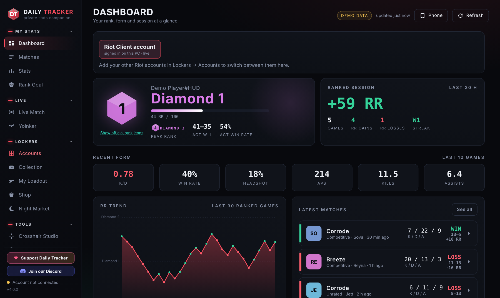
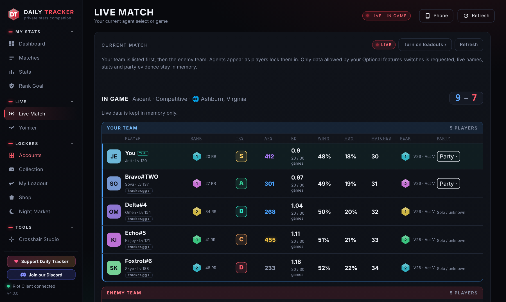
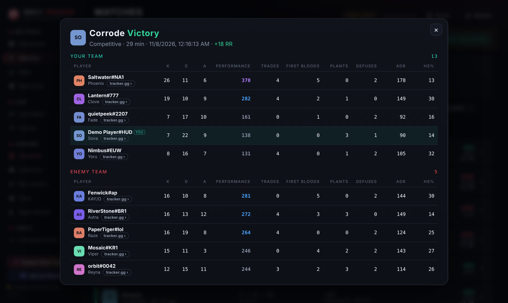
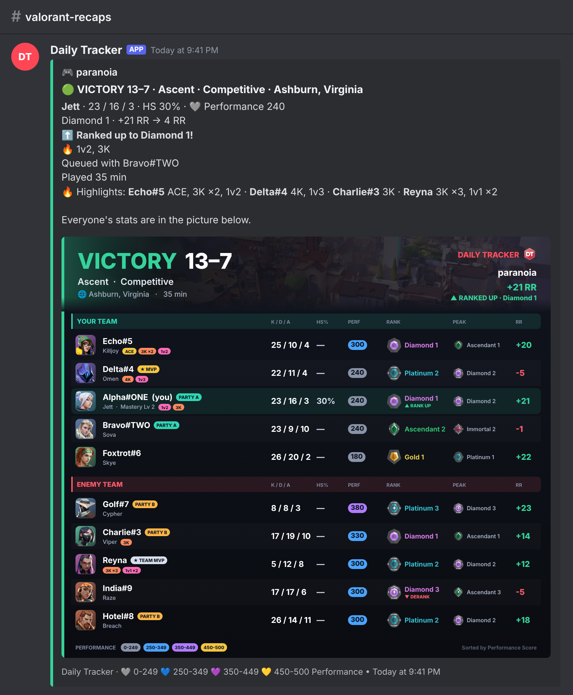

<h1 align="center">Daily Tracker</h1>

A private VALORANT stats companion for Windows: your rank and RR, matches, stats, lockers for all your accounts,
crosshairs, Discord match recaps and more. It runs only on your PC.

**Download:** get **Daily-Tracker.exe** from the [latest release](https://github.com/paranoia1x/Daily-Tracker-Releases/releases/latest)
and double-click it. No installation or administrator rights needed; it updates itself.

Questions, ideas or bugs? Come say hi on [Discord](https://discord.gg/dEws4Sq9wV).

## A look inside

**Dashboard:** your rank, RR trend, ranked session and latest matches at a glance.

**Live Match:** everyone in your game with their rank, peak, Performance Score and who queued together.

**Match scoreboards:** every match with the full post-match scoreboard.

**Discord match recaps:** a recap of each game posted to your Discord channel, with a scoreboard picture.

Screenshots use demo data and made-up players.

Daily Tracker isn't endorsed by Riot Games and doesn't reflect the views or opinions of Riot Games or anyone
officially involved in producing or managing Riot Games properties. Riot Games, VALORANT and all associated
properties are trademarks or registered trademarks of Riot Games, Inc.
